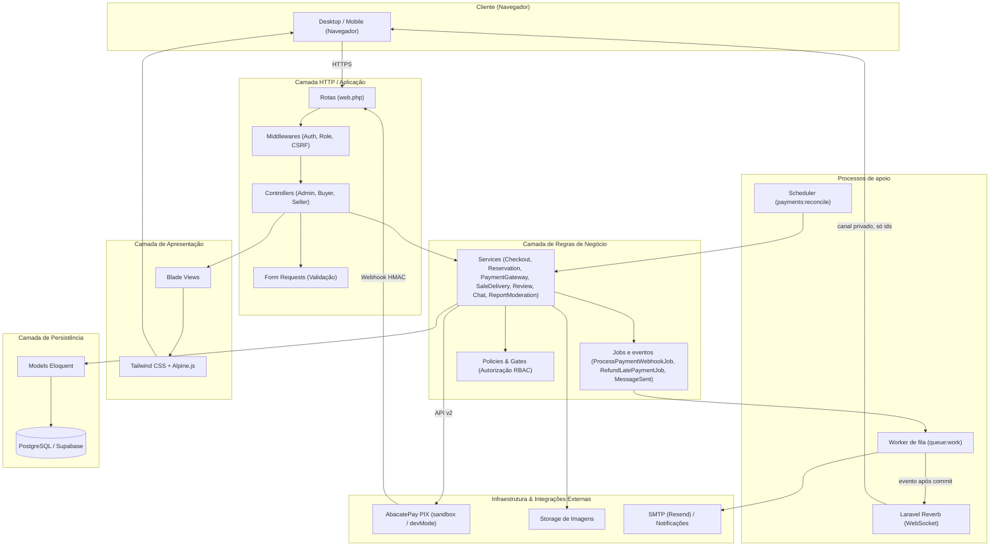
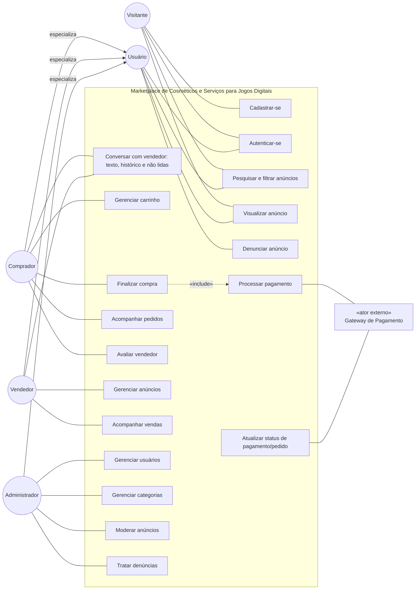
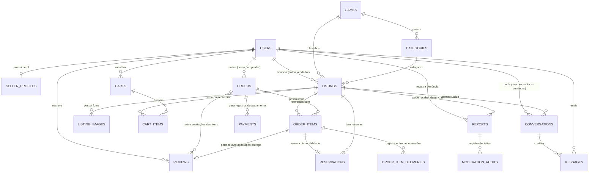

<div align="center">

# 🎮 TheMerchant

### Marketplace de cosméticos e serviços para jogos digitais

**Skins, coaching e conexões entre jogadores.**<br>
Projeto acadêmico de Laboratório de Engenharia de Software III · FATEC Praia Grande · 2026

<p>
  
  
</p>

<p>
  
  
  
  
  
</p>

<p>
  
  
  
  
  
  
</p>

<p>
  <a href="#sobre">Sobre</a> ·
  <a href="#tecnologias">Tecnologias</a> ·
  <a href="#requisitos">Requisitos</a> ·
  <a href="#arquitetura">Arquitetura</a> ·
  <a href="#executar">Executar</a> ·
  <a href="#testes">Testes</a> ·
  <a href="#roadmap">Roadmap</a>
</p>

</div>

---

> **Situação em 25/11/2026:** o pagamento usa a AbacatePay (PIX, API v2) em **modo de desenvolvimento (sandbox)**, sem dinheiro real. Cobrança no provedor, webhook real com assinatura HMAC e idempotência foram homologados localmente em 12/11/2026 ([#16](https://github.com/IgorMarcoli/TheMerchant/issues/16)). Ainda faltam a compra concorrente em PostgreSQL, o webhook fora de ordem com eventos reais e a repetição do fluxo no deploy do Render, que hoje responde HTTP 500. A [matriz de rastreabilidade](docs/RASTREABILIDADE.md) separa o que está implementado do que está pendente.

| 🚀 Executar localmente | 🧪 Validar a aplicação | 📌 Acompanhar entregas | 🎤 Apresentar |
| :---: | :---: | :---: | :---: |
| [Guia de instalação e execução](docs/EXECUCAO.md) | [Guia de testes](docs/TESTES.md) e [rastreabilidade](docs/RASTREABILIDADE.md) | [Issues e milestones](ISSUES.md) | [Roteiro de apresentação](docs/ROTEIRO_APRESENTACAO.md) |

---

## 👥 Membros da Equipe

| Nome Completo | Matrícula / Função | GitHub |
| :--- | :--- | :--- |
| **Igor Marcoli Bastos** | Desenvolvedor Full-Stack | [@IgorMarcoli](https://github.com/IgorMarcoli) |
| **João Pedro Martins de Andrade** | Desenvolvedor Full-Stack | [@JoaoPMA23](https://github.com/JoaoPMA23) |

> 📌 *Este repositório e a documentação na raiz atendem às especificações e entregas do Laboratório de Engenharia de Software III (2026), documentando o escopo, arquitetura, requisitos e modelo de dados.*

---

<a id="sobre"></a>

## 📋 Sobre o Projeto e Justificativa

O mercado de jogos digitais expandiu de forma vertiginosa a demanda por **itens cosméticos** (como *skins*, temas visuais, pacotes gráficos e avatares) e **serviços associados** (como *coaching* e personalizações autorizadas).

Atualmente, grande parte dessas negociações acontece na informalidade — por meio de grupos de redes sociais, fóruns e mensageiros instantâneos. Nesses ambientes, os usuários enfrentam:
- **Ausência de padronização** nas ofertas e nos pagamentos;
- **Baixa rastreabilidade** das transações;
- **Alta vulnerabilidade** a golpes, fraudes, falsidade ideológica e chargebacks;
- **Inexistência de mecanismos de reputação e moderação** auditáveis.

O **TheMerchant** surge como uma plataforma web centralizada para intermediar transações entre compradores e vendedores com transparência, reputação verificada, integração segura com gateways de pagamento externos e moderação administrativa.

> ⚠️ **Observação de Escopo e Conformidade:** Itens e serviços somente poderão ser anunciados quando forem estritamente compatíveis com as políticas, termos de uso e restrições da publicadora do jogo ou plataforma correspondente.

---

## 🎯 Objetivos

### Objetivo geral
Desenvolver uma plataforma web de marketplace que permita anunciar, pesquisar, comprar e acompanhar produtos e serviços digitais relacionados a jogos, intermediando as negociações com segurança, rastreabilidade e controle administrativo.

### Objetivos específicos
- 🔐 Permitir cadastro, autenticação, recuperação de acesso e controle de perfis de usuário (*RBAC*).
- 📦 Possibilitar que vendedores cadastrem, editem, pausem e removam anúncios de produtos e serviços digitais com galeria de imagens.
- 🔍 Permitir pesquisa e filtragem estruturada por jogo, categoria, faixa de preço e avaliação do vendedor.
- 🛒 Disponibilizar carrinho de compras e fluxo seguro de checkout.
- 💳 Integrar a aplicação a um gateway de pagamento externo sem armazenar dados sensíveis de cartão na plataforma.
- 📈 Permitir o acompanhamento completo do status de pedidos (comprador) e vendas (vendedor).
- ⭐ Implementar avaliação e reputação de vendedores somente após uma compra efetivamente concluída.
- 🛡️ Disponibilizar painel administrativo para moderação de denúncias, anúncios, categorias e usuários.
- 💬 Permitir conversa privada de texto em tempo real entre interessado e vendedor, antes e depois da compra (ampliação de escopo de 18/09/2026).
- 🏛️ Construir a solução sobre uma arquitetura organizada, modular e de fácil manutenção utilizando PHP 8.2+ e o ecossistema Laravel.

---

## Banco de dados

O ambiente padrão usa PostgreSQL no Supabase. Consulte [a configuração local, diagnóstico e diferenças do XAMPP](docs/SUPABASE.md). Os testes usam SQLite em memória; a migration de adoção do chat não suporta MySQL.

## 👤 Perfis de Usuário

Uma pessoa usa a mesma conta para comprar e vender. `seller_profiles.status` controla a habilitação de vendas (`pending`, `approved`, `suspended`); `users.is_admin` concede administração separadamente. Administradores também precisam de perfil aprovado para criar seus próprios anúncios. Veja [o fluxo e a atualização do banco](docs/CONTAS_E_VENDEDORES.md).


| Perfil | Responsabilidades Principais |
| :--- | :--- |
| **Comprador** | Pesquisa produtos e serviços, gerencia o carrinho, finaliza compras, acompanha pedidos, avalia vendedores e pode denunciar anúncios. |
| **Vendedor** | Publica e gerencia seus próprios anúncios, acompanha vendas e utiliza as funcionalidades comuns disponíveis aos usuários da plataforma. |
| **Administrador** | Gerencia usuários e categorias, modera anúncios, trata denúncias e administra aspectos operacionais da plataforma. |

---

<a id="requisitos"></a>

## 📊 Requisitos do Sistema

### Requisitos Funcionais (RF)

| ID | Prioridade | Descrição |
| :--- | :---: | :--- |
| **RF01** | Alta | O sistema deve permitir que um visitante cadastre uma conta informando, no mínimo, nome, e-mail e senha, com uma conta única apta a comprar e solicitar aprovação para vender. |
| **RF02** | Alta | O sistema deve permitir autenticação, logout e controle de sessão de usuários cadastrados. |
| **RF03** | Alta | O sistema deve permitir verificação de e-mail e recuperação de acesso por meio de fluxo seguro. |
| **RF04** | Alta | Toda conta ativa pode comprar; vender exige perfil aprovado; administração depende de `users.is_admin`. |
| **RF05** | Alta | O vendedor deve poder cadastrar, editar, pausar e remover seus próprios anúncios. |
| **RF06** | Alta | Cada anúncio deve permitir informar jogo, categoria, título, descrição, preço, imagens e status. |
| **RF07** | Alta | O usuário deve poder pesquisar, filtrar e ordenar anúncios por jogo, categoria, faixa de preço e reputação do vendedor. |
| **RF08** | Alta | O sistema deve exibir uma página de detalhes do anúncio com informações do produto ou serviço, vendedor e reputação disponível. |
| **RF09** | Alta | O comprador deve poder gerenciar o carrinho, adicionando, removendo e ajustando itens antes da compra. |
| **RF10** | Alta | O comprador deve poder finalizar a compra por meio do checkout, gerando o pedido correspondente. |
| **RF11** | Alta | A finalização da compra deve incluir o processamento do pagamento por meio de um gateway externo. |
| **RF12** | Alta | O sistema deve receber notificações/webhooks do gateway e atualizar de forma idempotente os status do pagamento e do pedido. |
| **RF13** | Alta | O comprador deve poder acompanhar o histórico e o status de seus pedidos. |
| **RF14** | Média | O vendedor deve poder acompanhar as vendas relacionadas aos seus anúncios. |
| **RF15** | Média | O comprador deve poder avaliar o vendedor somente após a conclusão da compra. |
| **RF16** | Média | O usuário autenticado deve poder denunciar um anúncio, informando o motivo da denúncia. |
| **RF17** | Alta | O administrador deve poder gerenciar usuários, incluindo consulta, alteração de status e demais ações administrativas previstas pela plataforma. |
| **RF18** | Alta | O administrador deve poder gerenciar as categorias utilizadas para classificar anúncios. |
| **RF19** | Alta | O administrador deve poder moderar anúncios, podendo ocultar, bloquear ou restaurar anúncios conforme as regras da plataforma. |
| **RF20** | Alta | O administrador deve poder consultar e tratar denúncias registradas pelos usuários. |

### Chat em tempo real — ampliação de escopo

Incluído na v1 em 18/09/2026, como revisão de escopo solicitada pelo professor responsável. Backend e tempo real entregues na #30 ([guia do chat](docs/CHAT_TEMPO_REAL.md)); interface e regressão nas #31 e #32, com teste usando Reverb e worker reais em 24/11/2026; atualização do documento acadêmico na #33. Critérios de aceite completos em [requirements.md](requirements.md).

| ID | Prioridade | Descrição |
| :--- | :---: | :--- |
| **RF21** | Alta | Iniciar e retomar conversa privada com o vendedor pelo anúncio ou pela compra. |
| **RF22** | Alta | Enviar e receber texto em tempo real, com persistência e autorização dos participantes. |
| **RF23** | Média | Consultar histórico, mensagens não lidas e recuperar mensagens após reconexão. |

### Requisitos Não Funcionais (RNF)

| ID | Categoria | Descrição |
| :--- | :--- | :--- |
| **RNF01** | Usabilidade | A aplicação deve ser acessível por navegador web e possuir layout responsivo para desktop e dispositivos móveis. |
| **RNF02** | Segurança | As senhas devem ser armazenadas por hash seguro e irreversível (Bcrypt/Argon2id), nunca em texto puro ou criptografia reversível. |
| **RNF03** | Segurança | A aplicação deve aplicar autenticação, autorização por perfil (*Policies/Gates*), proteção CSRF e validação estrita em todas as operações sensíveis. |
| **RNF04** | Segurança | Dados sensíveis de cartão não devem ser armazenados pela plataforma; o processamento é 100% delegado ao gateway externo. |
| **RNF05** | Desempenho | Listagens e buscas devem responder em tempo adequado, com consultas paginadas e índices no banco de dados para campos de filtro frequentes. |
| **RNF06** | Integridade | Operações críticas de pedido e pagamento devem utilizar transações ACID (`DB::transaction`) no banco ao alterar múltiplos registros relacionados. |
| **RNF07** | Privacidade | Coletar apenas os dados necessários para a operação comercial, em conformidade com as boas práticas e legislação de privacidade (LGPD). |
| **RNF08** | Manutenibilidade | O código deve seguir organização em camadas (MVC + Services + Form Requests), padrões PSR-12, migrations versionadas e testes automatizados. |
| **RNF09** | Observabilidade | Falhas de integração, webhooks e erros críticos de sistema devem ser registrados em logs estruturados sem exposição de dados sensíveis. |

---

## 🚫 Limites de Escopo (Primeira Versão)

| Dentro do Escopo (v1) | Fora do Escopo (v1) |
| :--- | :--- |
| ✅ Aplicação web 100% responsiva (Desktop / Mobile) | ❌ Aplicativo mobile nativo (iOS / Android) |
| ✅ Catálogo, carrinho, checkout e webhook assíncrono | ❌ Integração direta com APIs oficiais de jogos (Steam, Riot) |
| ✅ Reputação pós-compra e chat privado de texto com vendedor | ❌ Anexos, áudio/vídeo e grupos no chat |
| ✅ Painel administrativo de moderação e denúncias | ❌ Múltiplos idiomas e múltiplas moedas (foco BRL) |
| ✅ Gateway externo (AbacatePay, PIX, em sandbox na apresentação) | ❌ Carteira financeira própria ou custódia interna de valores |
| ✅ Coaching com sessões, capacidade e combinação de horários | ❌ Agenda automática de coaching |

---

<a id="tecnologias"></a>

## 🛠️ Stack Tecnológica

**Linguagens:** PHP no backend; JavaScript nas interações; HTML e CSS na apresentação. O projeto utiliza Laravel 12, com dependências resolvidas para PHP 8.2. PostgreSQL/Supabase é o banco principal; os testes usam SQLite em memória.

| Camada / Função | Tecnologia | Descrição |
| :--- | :--- | :--- |
| **Linguagem & Back-end** | **PHP 8.2+ / Laravel 12** | Monólito modular baseado no padrão MVC do Laravel. |
| **Camada de Apresentação** | **Blade + Tailwind CSS + Alpine.js** | Renderização server-side rápida, estilização moderna e componentes interativos leves. |
| **Banco de Dados** | **PostgreSQL (Supabase)** | Migrations e Eloquent no schema `laravel`. SQLite em memória nos testes e SQLite local nas homologações registradas; a migration de adoção do chat não suporta MySQL. |
| **Autenticação & Autorização** | **Laravel Sessions & Policies** | Sessões seguras com cookies HTTP-only, CSRF e Laravel Policies/Gates. |
| **Integração de Pagamentos** | **AbacatePay (PIX, API v2)** | Camada de serviço desacoplada (`PaymentGatewayService` + `PaymentGateway`) com webhooks autenticados (segredo + HMAC), reservas com expiração, reconciliação e idempotência. Usada em modo de desenvolvimento (sandbox). Detalhes em [docs/PAGAMENTOS.md](docs/PAGAMENTOS.md). |
| **Armazenamento de Arquivos** | **Laravel Storage (Disk Local / S3)** | Armazenamento de imagens de anúncios e perfis com links simbólicos públicos. |
| **Filas & Tarefas Assíncronas** | **Laravel Queues / Jobs + Scheduler** | Worker (`queue:work`) para e-mails, processamento de webhooks (`ProcessPaymentWebhookJob`), estornos de pagamento tardio (`RefundLatePaymentJob`) e avisos do chat (`MessageSent`). O scheduler roda `payments:reconcile` a cada minuto. |
| **Testes Automatizados** | **Pest / PHPUnit + Node test runner** | Testes de feature e unidade em SQLite em memória, testes JavaScript em `tests/js` e CI no GitHub Actions. |
| **Versionamento** | **Git + GitHub** | Branches, revisão de código e acompanhamento de entregas. |
| **Chat em tempo real** | **Laravel Reverb + Echo** | Canais privados por conversa levando só o aviso de nova mensagem; texto, histórico paginado e reconexão pelo HTTP autorizado. Veja [docs/CHAT_TEMPO_REAL.md](docs/CHAT_TEMPO_REAL.md). |
| **Build e deploy** | **Vite / Docker** | `vite.config.js` versionado e validado no CI; o layout ainda carrega Tailwind e Alpine por CDN. O `Dockerfile` é usado no deploy do Render ([guia](docs/DEPLOY_RENDER.md)). |

---

<a id="arquitetura"></a>

## 🏛️ Arquitetura da Aplicação

A solução adota uma **arquitetura monolítica modular baseada em camadas no Laravel**:



O navegador do chat usa Laravel Echo (pusher-js) para receber o aviso de nova mensagem e busca o texto pelo HTTP autorizado. Sem Reverb ou sem worker, as mensagens continuam gravadas e chegam pela sincronização HTTP periódica. Não há carteira própria: todo valor passa pelo gateway externo.

### Visão dos casos de uso

A visualização Mermaid resume os casos de uso; o diagrama UML formal é mantido no documento acadêmico. O ator **Usuário** é uma abstração de modelagem — não uma conta separada para cada atividade — e é especializado pelos atores **Comprador**, **Vendedor** e **Administrador** via herança/generalização; os atores representam capacidades que podem coexistir na mesma conta. O **Visitante** representa quem ainda não possui conta, enquanto o **Gateway de Pagamento** atua como ator externo.



#### Critérios de Modelagem UML Aplicados
- **Associações contínuas:** Associações entre atores e casos de uso representadas por linhas contínuas, sem setas.
- **Generalização de Atores:** Comprador, Vendedor e Administrador especializam o ator geral `Usuário`, herdando as ações comuns.
- **Relacionamento `<<include>>` estrito:** O único relacionamento obrigatório entre casos de uso é `Finalizar compra <<include>> Processar pagamento`.
- **Independência de Carrinho e Checkout:** `Gerenciar carrinho` e `Finalizar compra` não possuem relacionamento direto no diagrama, pois representam sequência de fluxo e não relação de caso de uso.
- **Ações administrativas atômicas:** `Gerenciar usuários`, `Gerenciar categorias`, `Moderar anúncios` e `Tratar denúncias` são casos de uso separados e atômicos.
- **Gateway como Ator Externo:** Participa ativamente dos casos `Processar pagamento` e `Atualizar status de pagamento/pedido`.

---

## 🗄️ Modelo de Dados

A modelagem de dados foi projetada para garantir integridade referencial, rastreabilidade contábil e histórico imutável de transações. As migrations em `database/migrations` são a referência do schema.

| Entidade | Tabela | Finalidade |
| :--- | :--- | :--- |
| **User** | `users` | Dados de autenticação, status (`active`/`suspended`) e permissão administrativa (`is_admin`). Não há coluna de papel: a mesma conta compra e, se aprovada, vende. |
| **SellerProfile** | `seller_profiles` | Dados específicos de vendedor, bio, pontuação agregada de reputação e total de vendas. |
| **Game** | `games` | Catálogo de jogos suportados (ex: CS2, Valorant, League of Legends, Dota 2). |
| **Category** | `categories` | Categorias vinculadas a itens (ex: Skins de Arma, Facas, Coaching, Luvas). |
| **Listing** | `listings` | Anúncios de produtos ou serviços com título, descrição, preço, status, capacidade (`capacity`), duração da sessão, fuso e arquivamento. |
| **ListingImage** | `listing_images` | Galeria de imagens de cada anúncio, com flag de imagem principal. |
| **Cart** | `carts` | Carrinho de compras ativo do comprador (persistido por usuário ou sessão). |
| **CartItem** | `cart_items` | Itens e quantidades adicionados ao carrinho antes do checkout. |
| **Order** | `orders` | Pedido consolidado contendo valor total, comprador e status do fluxo de entrega. |
| **OrderItem** | `order_items` | Itens adquiridos no pedido, **preservando preço, tipo, quantidade, duração e condições** do momento da compra. |
| **Reservation** | `reservations` | Reserva de disponibilidade por item do pedido (`active`, `confirmed`, `released`), com expiração de 15 minutos. |
| **OrderItemDelivery** | `order_item_deliveries` | Registro de cada entrega ou sessão de coaching do item, numerada e única. |
| **Payment** | `payments` | Cobrança PIX no gateway: transação externa, status normalizado, QR Code, vencimento e estorno. |
| **PaymentEvent** | `payment_events` | Webhooks recebidos, um por `event_id`, com payload sanitizado e resultado do processamento. |
| **Review** | `reviews` | Avaliações com nota (1 a 5) e comentário, uma por item pago e entregue. |
| **Report** | `reports` | Denúncias de anúncios ou comportamentos irregulares enviadas para moderação administrativa. |
| **ModerationAudit** | `moderation_audits` | Histórico de decisões de moderação: bloqueio, restauração, parecer e estados anterior e novo. |
| **Conversation** | `conversations` | Conversa única por comprador, vendedor e anúncio, com cursor de leitura de cada participante. |
| **Message** | `messages` | Mensagens de texto com `client_uuid` único por conversa e remetente. |

### Diagrama de Relacionamentos (ERD)



`payment_events` guarda os webhooks pela identidade do evento e do `charge_id`, sem chave estrangeira para `payments`. Os cursores de leitura (`buyer_last_read_message_id`, `seller_last_read_message_id`) ficam em `conversations` e são validados pela aplicação.

---

## 🔄 Ciclos de Vida e Regras de Negócio

> **Regra implementada (#13, #14, #18):** checkout cria reserva de 15 minutos; o pagamento confirmado no provedor consome a reserva. Coaching continua disponível enquanto houver capacidade. Detalhes em [requirements.md](requirements.md), no [contrato de domínio](docs/CONTRATO_DOMINIO.md) e em [pagamentos](docs/PAGAMENTOS.md).

### 1. Estados do Anúncio (`listings.status`)
- `rascunho`: Anúncio salvo pelo vendedor sem visibilidade pública no catálogo.
- `publicado`: Ativo e visível nas buscas e filtros.
- `pausado`: Temporariamente ocultado pelo vendedor.
- `vendido`: Item único já comercializado ou sem estoque disponível.
- `bloqueado`: Suspenso pela equipe de moderação administrativa por inconformidade com as regras.

### 2. Estados do Pedido (`orders.status`)
- `pendente`: Pedido gerado com reserva ativa, aguardando confirmação do gateway de pagamento.
- `pago`: Pagamento conferido no provedor (por webhook, pelo botão "Já paguei" ou pela reconciliação); itens passam a `em_entrega`.
- `em_andamento`: Valor previsto no schema e contado nas métricas do painel; nenhuma transição atual o utiliza.
- `concluido`: Todos os itens entregues; avaliação é habilitada por item pago e entregue, sem aguardar outros vendedores.
- `cancelado`: Pedido cancelado por expiração, recusa definitiva do gateway ou pagamento tardio (estornado no provedor).

### 3. Estados do item (`order_items.delivery_status`) e da reserva (`reservations.status`)
- Item: `aguardando_pagamento` → `em_entrega` (pagamento confirmado) → `entregue` (vendedor registra a entrega; coaching só depois de todas as sessões).
- Reserva: `active` → `confirmed` (pagamento válido, baixa a capacidade) ou `released` (expiração, recusa, cancelamento ou pagamento tardio).

---

## 🌐 Rotas Principais da Aplicação

| Método | Rota | Descrição | Acesso |
| :--- | :--- | :--- | :--- |
| `GET` | `/` | Vitrine com jogos ativos e anúncios recentes | Público |
| `GET` | `/anuncios` | Catálogo com paginação, filtros (inclusive nota mínima do vendedor) e ordenação | Público |
| `GET` | `/anuncios/{slug}` | Detalhes do anúncio, galeria de fotos e dados do vendedor | Público |
| `GET` / `POST` | `/cadastro`, `/login`, `/esqueci-minha-senha`, `/verificar-email` | Cadastro, sessão, recuperação de senha e verificação de e-mail | Visitante / Autenticado |
| `GET` / `POST` | `/quero-vender` | Pedido de habilitação para vender | Autenticado |
| `GET` / `POST` / `PATCH` / `DELETE` | `/carrinho`, `/carrinho/adicionar/{listing}`, `/carrinho/itens/{item}` | Consultar, adicionar, ajustar sessões e remover itens | Autenticado |
| `GET` / `POST` | `/checkout`, `/checkout/processar` | Resumo e criação do pedido com reserva e PIX | Autenticado |
| `POST` | `/checkout/{order}/pagamento`, `/atualizar`, `/simular-pagamento` | Gerar PIX novamente, consultar o provedor ("Já paguei") e simular pagamento no modo dev | Comprador do pedido |
| `POST` | `/api/webhooks/payment` | Webhook da AbacatePay, com segredo e assinatura HMAC | Externo |
| `GET` | `/pedidos`, `/pedidos/{order}` | Histórico e detalhe dos pedidos | Comprador |
| `POST` | `/pedidos/{order}/avaliar/{item}` | Avaliação por item entregue | Comprador |
| `POST` | `/denunciar/anuncio/{listing}` | Denúncia de anúncio | Autenticado |
| `GET` / `POST` / `PATCH` | `/chat`, `/chat/iniciar`, `/chat/{conversation}/mensagens`, `/chat/nao-lidas` | Caixa de entrada, conversa, envio, histórico e não lidas | Participantes |
| `GET` / `POST` / `PATCH` | `/vendedor/anuncios` | Gestão de anúncios próprios | Vendedor aprovado |
| `GET` / `PATCH` | `/vendedor/vendas`, `/vendedor/vendas/{item}/entregar` | Vendas recebidas e registro de entrega ou sessão | Vendedor |
| `GET` | `/admin/dashboard` | Volume transacionado, pedidos, usuários e anúncios | Administrador |
| `GET` / `PATCH` | `/admin/usuarios`, `/admin/categorias`, `/admin/jogos/{game}/status` | Contas, aprovação de vendedores, categorias e jogos | Administrador |
| `GET` / `PATCH` | `/admin/denuncias`, `/admin/denuncias/{report}/moderar`, `/admin/denuncias/{report}/restaurar-anuncio` | Fila de denúncias, julgamento e restauração de anúncio | Administrador |

---

<a id="executar"></a>

## 🚀 Como Executar o Projeto

Pré-requisitos: PHP 8.2+ compatível com o lockfile, Composer 2, Node.js 22+ e PostgreSQL (Supabase) ou SQLite local. Consulte o [guia completo](docs/EXECUCAO.md) para extensões, contas de demonstração, filas e solução de problemas, e o [roteiro de apresentação](docs/ROTEIRO_APRESENTACAO.md) para subir app, Reverb e worker juntos.

```powershell
git clone https://github.com/IgorMarcoli/TheMerchant.git
cd TheMerchant
composer install
if (!(Test-Path .env)) { Copy-Item .env.example .env }
```

Configure um banco **dedicado** (PostgreSQL ou SQLite local) e as credenciais no `.env`. Para um primeiro teste com arquivos locais e jobs síncronos, ajuste:

```dotenv
APP_URL=http://127.0.0.1:8000
SESSION_DRIVER=file
CACHE_STORE=file
QUEUE_CONNECTION=sync
```

`sync` executa jobs na requisição: serve para desenvolvimento inicial, não comprova processamento assíncrono. Para o chat em tempo real use `QUEUE_CONNECTION=database`, `BROADCAST_CONNECTION=reverb` e os processos descritos em [docs/CHAT_TEMPO_REAL.md](docs/CHAT_TEMPO_REAL.md).

```powershell
php artisan config:clear
php artisan key:generate
php artisan migrate
php artisan db:seed
php artisan storage:link
php artisan serve --host=127.0.0.1 --port=8000
```

Gere a chave apenas na configuração inicial de um ambiente novo. Execute o seeder apenas na base nova: ele usa registros fixos e não é idempotente. Para recomeçar do zero, `php artisan migrate:fresh --seed` apaga todas as tabelas: use somente em banco local descartável. Não é necessário iniciar Vite para o layout atual.

Abra [o catálogo local](http://127.0.0.1:8000/anuncios) ou [o login](http://127.0.0.1:8000/login). As contas fictícias e os passos detalhados estão no [guia de execução](docs/EXECUCAO.md).

<a id="testes"></a>

## 🧪 Testes e Validações

O workflow [Testes PHP](.github/workflows/php-tests.yml) executa os testes de `tests/Unit` e `tests/Feature` automaticamente em pushes e pull requests, com PHP 8.2 e 8.3 e SQLite em memória. Consulte os resultados na aba **Actions** do repositório e os detalhes no [guia de testes](docs/TESTES.md#github-actions).

Verificações sem alterar o banco:

```powershell
composer validate --no-check-publish
composer check-platform-reqs
php artisan route:list --except-vendor
php artisan test
npm test
vendor/bin/pint --test
```

O `phpunit.xml` força SQLite em memória, fila `sync` e e-mail `array`, então a suíte não toca o banco de desenvolvimento. Último registro: 234 testes PHP e 23 testes JavaScript aprovados, com Pint aprovado, em 24/11/2026 ([#21](https://github.com/IgorMarcoli/TheMerchant/issues/21)). O mapa requisito → teste está na [matriz de rastreabilidade](docs/RASTREABILIDADE.md).


---

## 📁 Estrutura de Pastas do Projeto

Visão resumida das pastas principais. A lista completa de controllers, services e testes está no próprio repositório.

```
TheMerchant/
├── README.md, requirements.md, specs.md, ISSUES.md, CONTRIBUTING.md, agents.md
├── Dockerfile, docker/entrypoint.sh     # Imagem usada no Render (app, worker, scheduler ou Reverb)
├── .github/workflows/php-tests.yml      # CI: PHP 8.2/8.3, Pint, npm test e build
├── docs/
│   ├── EXECUCAO.md                      # Instalação e operação local
│   ├── TESTES.md                        # Testes, roteiros de homologação e evidências
│   ├── RASTREABILIDADE.md               # RF/RNF → issue → critério → evidência
│   ├── ROTEIRO_APRESENTACAO.md          # Demonstração passo a passo
│   ├── PAGAMENTOS.md                    # AbacatePay, reservas, webhook e estados
│   ├── CHAT_TEMPO_REAL.md               # Reverb, Echo, worker e roteiro com duas sessões
│   ├── CONTRATO_DOMINIO.md              # Disponibilidade, sessões e conclusão por item (#29)
│   ├── AUTENTICACAO.md, CONTAS_E_VENDEDORES.md, SUPABASE.md, DEPLOY_RENDER.md
│   └── entrega/                         # Documento acadêmico (.docx)
├── app/
│   ├── Http/Controllers/{Admin,Auth,Buyer,Seller}/, ChatController.php, WebhookController.php
│   ├── Http/Requests/                   # Form Requests (cadastro, anúncio, checkout, chat, moderação)
│   ├── Models/                          # User, Listing, Order, OrderItem, Reservation, Payment, PaymentEvent,
│   │                                    # Review, Report, ModerationAudit, Conversation, Message...
│   ├── Policies/                        # Listing, Order, OrderItem, Review, Conversation, Report, User...
│   ├── Services/                        # Checkout, Reservation, PaymentGateway (+ Payments/), SaleDelivery,
│   │                                    # Review, Chat, ReportModeration, Catalog, SellerAccount...
│   ├── Jobs/                            # ProcessPaymentWebhookJob, RefundLatePaymentJob, SendPasswordResetLink
│   ├── Events/MessageSent.php           # Aviso do chat enviado ao Reverb após o commit
│   ├── Broadcasting/                    # Autorização do canal privado da conversa
│   └── Console/Commands/                # payments:reconcile, test:db
├── database/
│   ├── migrations/                      # Schema versionado (inclui reservas, eventos de pagamento e chat)
│   └── seeders/                         # DatabaseSeeder (contas, jogos, categorias), DemoCatalogSeeder e FreeListingsSeeder
├── resources/views/                     # Blade: vitrine, catálogo, carrinho, checkout, pedidos, vendas, chat, admin
├── routes/web.php, api.php, channels.php, console.php
└── tests/
    ├── Feature/                         # Fluxos HTTP, pagamentos, chat, moderação e segurança
    ├── Unit/                            # Gateway AbacatePay e rótulos de status
    └── js/                              # Testes do navegador (chat, filtros, formulário de anúncio, avaliação)
```

---

<a id="roadmap"></a>

## 🗺️ Roadmap

| Milestone | Entrega |
| :--- | :--- |
| [M1](https://github.com/IgorMarcoli/TheMerchant/milestone/10) | Fundação, autenticação e perfis; inclui pendências de RF03 e segurança |
| [M2](https://github.com/IgorMarcoli/TheMerchant/milestone/11) | Catálogo, anúncios, busca e regras de cosméticos/coaching |
| [M3](https://github.com/IgorMarcoli/TheMerchant/milestone/12) | Carrinho, reservas, checkout e pagamentos |
| [M4](https://github.com/IgorMarcoli/TheMerchant/milestone/13) | Pós-venda, entrega, reputação e chat |
| [M5](https://github.com/IgorMarcoli/TheMerchant/milestone/14) | Administração, moderação, qualidade e apresentação |

Em 25/11/2026, as issues abertas são #16 (homologação do pagamento: concorrência em PostgreSQL, webhook fora de ordem e Render), #21 (validação ponta a ponta registrada, aguardando o fechamento), #25 (revisão final e apresentação) e #33 (documento acadêmico e diagramas). Consulte o GitHub para o estado atualizado; uma issue fechada não substitui evidência de teste.


---

## 📑 Documentação Complementar

- 🚀 [Guia de Execução](docs/EXECUCAO.md) — Instalação, `.env`, banco, filas e problemas frequentes.
- 🧪 [Guia de Testes](docs/TESTES.md) — Comandos isolados, matriz de validação e evidências.
- ✉️ [Verificação e Recuperação de Acesso](docs/AUTENTICACAO.md) — Laravel, SMTP, filas e configuração de RF03.
- 💬 [Chat em Tempo Real](docs/CHAT_TEMPO_REAL.md) — Reverb, worker, TLS, origens permitidas, revogação de acesso e roteiro com duas sessões.
- 💳 [Pagamentos](docs/PAGAMENTOS.md): AbacatePay em sandbox, reservas, webhook, estados e homologação da #16.
- 🔗 [Rastreabilidade](docs/RASTREABILIDADE.md): cada RF e RNF ligado à issue, ao critério de aceite e à evidência.
- 🎤 [Roteiro de Apresentação](docs/ROTEIRO_APRESENTACAO.md): demonstração passo a passo com as contas do seeder.
- 📄 [Documento acadêmico](docs/entrega/TheMerchant_Documentacao_Modelagem_PoC.docx): modelagem, requisitos e evidências para a disciplina.

- 📋 [Requisitos Detalhados (`requirements.md`)](./requirements.md) — Matriz completa de Requisitos Funcionais, Não Funcionais e Regras de Negócio.
- 📐 [Especificações Técnicas & ERD (`specs.md`)](./specs.md) — Dicionário de dados, máquina de estados e contratos dos Services.
- 📌 [Planejamento de Sprints & Issues (`ISSUES.md`)](./ISSUES.md) — Backlog dividido em 5 Milestones com distribuição equilibrada de tarefas da equipe.
- 🤝 [Guia de Contribuição (`CONTRIBUTING.md`)](./CONTRIBUTING.md) — Diretrizes de Git Flow, branches e commits semânticos.
- 🤖 [Diretrizes para Agentes (`agents.md`)](./agents.md) — Contexto de desenvolvimento e padrões arquiteturais para automações e LLMs.

---

## 📄 Licença

Projeto desenvolvido para fins acadêmicos na FATEC Praia Grande. O `composer.json` declara licença MIT; conferir a inclusão do arquivo de licença antes da distribuição.
